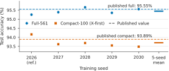
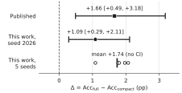

# Reproducing Gao et al. (2026): how much accuracy does a compact HAR model lose?

**Ikram Gafai** · Independent ML reproduction · UCI Human Activity Recognition · XGBoost

Gao et al. report that replacing **561 engineered features with 100** (an **82.17% reduction in input columns**) changes subject-independent activity-recognition accuracy from **95.55% to 93.89%**. I chose this result because compact representations could matter in continuous activity sensing, and the public, subject-disjoint dataset makes the numerical claim independently testable. I refitted the two published final XGBoost configurations to see whether the reported gap survives an implementation from scratch.

**Main finding.** The direction and approximate size of the reported gap reproduce: **1.66 percentage points in the paper versus 1.74 ± 0.38 pp across my five predefined training seeds**. But the magnitude is conditional on an unresolved ambiguity in the published feature names, and the two model configurations differ in hyperparameters as well as feature count.

**[Read the one-page evidence note (PDF)](paper/evidence_note.pdf)** · [Editable source](paper/evidence_note.typ) · [Experiment protocol](docs/PROTOCOL.md) · [Saved results](results/summary/results_table.md)

## Results, not just a headline number

<p align="center"></p>

*Figure 1. Official test accuracy for seeds 2026–2030; the bars at the right are five-seed means. Dashed lines are the published accuracies, not additional fitted models. Seed 2026 was declared as the reference before training.*

<p align="center"></p>

*Figure 2. Full-minus-compact accuracy gap. The two 95% confidence intervals are based on participant-level resampling; our interval covers the seed-2026 pair only. The five-seed mean has **no** bootstrap confidence interval.*

| Official held-out test set (2,947 windows) | Gao et al. (2026) | My reference seed, 2026 | Five seeds, mean ± SD |
|:--|--:|--:|--:|
| Full XGBoost, 561 features | 95.55% | 95.25% | **95.44 ± 0.16%** |
| Compact XGBoost, 100 named features | 93.89% | 94.16% | **93.70 ± 0.27%** |
| **Full − compact gap** | **+1.66 pp** | **+1.09 pp** | **+1.74 ± 0.38 pp** |
| 95% CI of the gap | [+0.49, +3.18] pp | [+0.29, +2.11] pp | Not computed |

In the reference run, the full model classified **2,807/2,947** windows correctly and the compact model **2,775/2,947**. Across all five seeds, the gap remained positive (**+1.09 to +2.07 pp**). This meets the numerical-agreement criterion fixed in the [protocol](docs/PROTOCOL.md), but it is **not a statistical-equivalence result**. Five seeds measure limited training variability; the bootstrap interval instead resamples the nine test participants for the predeclared reference pair.

## The part that was not straightforward

**The first obstacle appeared while mapping the supplement back to the dataset, before training.** The authors publish 100 feature *names*, not 100 unambiguous column indices. Ninety-one map to one UCI HAR column; nine `bandsEnergy` names each match **three axis-specific columns**. There are consequently **3⁹ = 19,683 possible mappings**, and the paper does not identify the nine choices. Selecting whichever mapping scored best on the official test set would contaminate the evaluation.

I fixed the **first occurrence (X-axis) convention before training**, then reported whole-block Y- and Z-axis alternatives as *exploratory sensitivity checks*, not competing models selected for the headline:

| Compact mapping | Five-seed compact accuracy, mean ± SD | Full − compact gap, mean |
|:--|--:|--:|
| **X-first — predefined primary** | **93.70 ± 0.27%** | **+1.74 pp** |
| Y-axis block — exploratory | 93.97 ± 0.10% | +1.47 pp |
| Z-axis block — exploratory | 94.29 ± 0.12% | +1.15 pp |

The gap stays positive in all **15 compact-model runs**, but its size changes materially. I cannot claim that X-first reproduces the authors' actual selected columns. The mapping audit also found **five numerically identical feature pairs** within the 100 named inputs, leaving 95 distinct feature vectors; that matters when interpreting feature importance. See [the index-level investigation](docs/FEATURE_MAPPING.md).

**Another limitation is built into the published comparison itself:** the full and compact models use **400 versus 300 boosting rounds**, and `colsample_bytree` **1.0 versus 0.8**. The experiment reproduces the reported *configuration-level* comparison, **not a causal ablation in which feature count is the only variable**.

## What I chose, and what I did not

**1. Refit the published final configurations.** I chose this narrower, numerically testable reproduction instead of reimplementing the entire Boruta → RFE search with unpublished participant-fold assignments. This isolates the published classifier comparison, but does **not** verify that an independent feature-selection run recovers the authors' subset. The original SHAP analysis and hyperparameter search are also outside scope.

**2. Resolve missing feature indices before looking at scores.** I declared X-first and ascending original-column order in advance rather than picking one of the mappings on test accuracy. The Y/Z experiments probe sensitivity; they cannot identify the authors' intended mapping.

**3. Treat participants, not windows, as the uncertainty unit.** UCI HAR windows overlap by 50% and multiple observations come from each person. I retained the official **21-train / 9-test participant-disjoint split**, trained with five fixed seeds, and calculated a paired **10,000-replicate participant bootstrap** for the seed-2026 model pair. A window-level bootstrap would understate dependence; a single seed alone would hide training variability.

## Reproduce and audit the evidence

The project needs **Python 3.11**, Git, Internet access for the public dataset download, and a CPU; there is no GPU requirement. The reported run used **Windows 11, AMD Ryzen 7 8845HS, 15.2 GB RAM, and one XGBoost training thread**. Python 3.11.3 and XGBoost 3.2.0 were used, with exact-greedy trees and `base_score=0.5` (the paper used **R XGBoost 1.7.7.1**). Dependencies are pinned in [`requirements-lock.txt`](requirements-lock.txt).

**Install — Linux/macOS:**

```bash
git clone https://github.com/ikram-gafai/gao2026-har-reproduction.git
cd gao2026-har-reproduction
python3.11 -m venv .venv
source .venv/bin/activate
python -m pip install -r requirements-lock.txt
python -m pip install -e . --no-deps
```

**Install — Windows PowerShell:**

```powershell
git clone https://github.com/ikram-gafai/gao2026-har-reproduction.git
cd gao2026-har-reproduction
py -3.11 -m venv .venv
.\.venv\Scripts\Activate.ps1
python -m pip install -r requirements-lock.txt
python -m pip install -e . --no-deps
```

If PowerShell blocks activation, run `Set-ExecutionPolicy -Scope Process RemoteSigned` in that terminal.

**Get the data and verify the committed experiment** (same commands in either shell):

```bash
python -m har_repro.cli prepare-data
python -m har_repro.cli build-mapping --check
python -m har_repro.cli validate-data
python -m pytest
python -m har_repro.cli verify-results
```

The data downloader tries the two official UCI HAR endpoints first and, only if both fail, an Internet Archive capture of the official archive. Every download must match a frozen **SHA-256**, and the extracted files are checked against their own checksums. `verify-results` reconstructs metrics for **all 20 saved fits** from test predictions and probabilities, checks subject IDs and labels, and regenerates the experiment summary, participant bootstrap, and numerical-agreement decision. **80 tests** passed in a fresh checkout. `validate-data` may update only the timestamp in a tracked validation report. [Data provenance](docs/DATA.md) · [Run-file guide](results/README.md)

**Check deterministic refitting** (optional; the full model takes several minutes on one thread):

```bash
python -m har_repro.cli verify-results --refit compact100-X__seed2026
python -m har_repro.cli verify-results --refit full561__seed2026
```

Both reference models reproduced their saved probabilities **bit for bit** in the reported environment. For a complete new set of 20 fits, use `python -m har_repro.cli run-experiments --results-dir rerun_results`. The target folder must be new; no published result files need to be overwritten.

**Rebuild the note and figures** in a separate paper environment (run from the repository root):

Linux/macOS:

```bash
python3.11 -m venv .venv-paper
source .venv-paper/bin/activate
python -m pip install -r paper/requirements-paper.txt
python paper/build_note.py
python paper/check_numbers.py
```

Windows PowerShell:

```powershell
py -3.11 -m venv .venv-paper
.\.venv-paper\Scripts\Activate.ps1
python -m pip install -r paper/requirements-paper.txt
python paper/build_note.py
python paper/check_numbers.py
```

The build uses the committed results to regenerate both SVG plots and the one-page Typst PDF. The number audit checks every value reported in the PDF.

## What the evidence does not establish

This is a reproduction of the **two final XGBoost classifiers**, not the original **Boruta/RFE selection, cross-validation search, or SHAP explanations**. Nine feature indices remain unresolved; 100 named features include five duplicate pairs; the Python and R implementations cannot be assumed bit-equivalent. Only **nine people** appear in the held-out test partition, and the dataset consists of controlled laboratory activities, not free-living or clinical monitoring. In particular, reduced input dimensionality does **not** by itself establish reduced end-to-end inference cost.

If I had one more week, I would run **nested participant-level feature selection**, keeping every selection step inside the training folds, compare Boruta → RFE against simpler selectors, and refit full and compact representations with **matched XGBoost hyperparameters**. I would then examine the gap per held-out participant and selected-feature stability—not just another aggregate accuracy number.

## Repository layout

```
configs/   frozen experiment parameters, data checksums, feature mapping, the paper's Supplementary Table S2
src/       har_repro package: data acquisition and loading, mapping, training, evaluation, experiment runner, audit
tests/     80 tests (synthetic implementation checks and structural checks on the real data)
results/   manifest, 20 saved runs (predictions, probabilities, metrics, configurations), summaries, repeatability
paper/     evidence note (PDF and Typst source), figure and build scripts, numerical audit
docs/      protocol, feature-mapping investigation, data provenance, environment, commit provenance
```

## Source, provenance, and license

- **Paper:** Gao, H. et al. (2026). [*Compact and Explainable Human Activity Recognition with Boruta-RFE Feature Selection and SHAP Interpretation*](https://doi.org/10.3390/app162010046). *Applied Sciences* 16(20), 10046. No author-released implementation was identified in the documented search.
- **Dataset:** Reyes-Ortiz, J. et al. (2013). [Human Activity Recognition Using Smartphones](https://doi.org/10.24432/C54S4K), UCI Machine Learning Repository, **CC BY 4.0**. Data are downloaded, not redistributed.
- **Code:** [MIT license](LICENSE). The paper's Supplementary Table S2 is attributed to its authors (CC BY 4.0).
- **Provenance:** [protocol](https://github.com/ikram-gafai/gao2026-har-reproduction/commit/ab93dfe16baa189523916476288cfe56fe4cc406), [implementation](https://github.com/ikram-gafai/gao2026-har-reproduction/commit/2678acadd135a4bc751a4c32e1d279976b2a3c51) and [saved-results](https://github.com/ikram-gafai/gao2026-har-reproduction/commit/be86b6d2ad4c1673cbbd6864377e413d8272e373) commits. Before first publication, these commits were recreated to correct author metadata; file contents and timestamps are unchanged. See [docs/PROVENANCE.md](docs/PROVENANCE.md) for the original identifiers, which `results/manifest.json` still cites, and how to verify them.
